# Coding Agent Policy Optimization

**面向仓库级代码任务的双层策略 Coding Agent，研究代码修改、验证反馈与失败恢复之间的执行约束。**

项目将 Agent 的决策与执行控制分为两层：**Model Policy** 根据仓库上下文和工具反馈选择动作，**Harness Policy** 管理工具可见性、上下文组织与验证恢复约束。通过统一的运行记录和配对评测，可以分析模型策略与 Harness 策略对任务结果的影响。

提供命令行任务执行和本地 Web 控制台，支持搜索代码、读取文件、应用补丁、运行测试、检查差异，以及持久化运行与 checkpoint 恢复。

一个具体问题是：Agent 读取代码后，开发者修改了同一文件，旧补丁即使仍能被 Git 应用，也可能覆盖新的修改。本项目在执行层校验读取版本，在冲突后要求重新读取，并将后续修改与验证纳入同一条轨迹。模型负责决定如何修复，运行时负责检查这次写入是否仍有有效依据。


## 核心能力

- **双层策略编排**：结构化模型动作与独立 Harness 策略，支持 static / adaptive 配置。
- **仓库工具执行**：统一工具注册、参数校验、权限元数据和标准化执行反馈。
- **可恢复运行**：Web 任务使用受管 Git worktree，结合 SQLite、事件日志与 attempt 记录保存执行状态。
- **可追溯轨迹**：关联任务、仓库版本、模型版本、动作、观察、补丁、测试状态与调用开销。
- **数据与后训练**：支持成功轨迹和策略纠正数据构建、审核 Gate、重放、QLoRA SFT、RFT 数据筛选与 GRPO 训练。
- **配对评测**：提供 Base / Model-only / Harness-only / Joint 四组配置，以及统计分析、失败案例和复现报告导出。

## 系统架构

运行时将工作区状态、验证证据与候选补丁关联起来，结合工具反馈决定重读、重测或切换候选。



<details>
<summary>编辑与导出架构图</summary>

图的唯一编辑源为 [architecture.mmd](assets/architecture.mmd)，包含布局、节点、连线与莫兰迪配色。可在 Mermaid 编辑器中打开，或将源码粘贴到 [Mermaid Live Editor](https://mermaid.live/) 修改和导出。README 使用仓库内的 SVG，放大查看仍保持清晰。

安装 Node.js 后，在仓库根目录运行以下命令，同步生成 SVG 和 PNG（首次运行会下载固定版本的 Mermaid CLI）：

```powershell
./scripts/render-architecture.ps1
# 也可以使用本机浏览器：
./scripts/render-architecture.ps1 -BrowserPath 'C:\Program Files (x86)\Microsoft\Edge\Application\msedge.exe'
```

</details>

执行层检查动作参数、工具可用性、配置的权限及补丁读取版本；模型根据反馈决定修复内容。Checkpoint 用于运行记录与恢复校验，candidate 用于补丁方案保存与选择。候选切换仍需校验当前工作区和读取依据，切换后重新验证。

### Model Policy 与 Harness Policy

| 层次 | 职责 | 主要配置 |
|---|---|---|
| Model Policy | 根据任务、代码和历史反馈选择下一步动作 | 模型、解码参数、上下文与输出预算 |
| Static Harness | 提供固定的工具与上下文策略 | 历史长度、固定工具集合 |
| Adaptive Harness | 根据待验证补丁、失败恢复和工具错误调整执行策略 | 验证要求、恢复要求、上下文策略 |

Adaptive Harness 采用规则策略，并支持在 dev 集上对离散候选配置进行选择。模型训练与 Harness 配置选择分别管理，通过组合实验分析两层策略的贡献。

文件版本检查属于执行层约束，Static 与 Adaptive 都不能绕过；两者的差异是如何组织上下文、约束动作并引导后续恢复。

### 工具集

| 工具 | 用途 |
|---|---|
| `search_code` | 按路径和匹配条件搜索仓库代码 |
| `read_file` | 按行范围读取文件 |
| `apply_patch` | 校验并应用 Git unified diff |
| `run_tests` | 执行配置的测试命令并返回状态与日志 |
| `inspect_diff` | 查看当前修改及 diff hash |
| `finish` | 提交任务结束状态 |

每次工具调用产生标准化结果，记录成功状态、错误码、观察与状态变化。Runner 将这些反馈送入下一轮模型决策，并保存完整轨迹。

### 人工编辑冲突与重新规划

本地仓库环境在 `read_file` 时记录完整文件的 SHA-256，在应用补丁前检查所有涉及文件的版本。已有文件需要先读取；文件发生变化时，整组补丁被拒绝，工具返回 `PATCH_CONFLICT`、受影响路径和版本信息。自适应 Harness 随后引导 Agent 重新读取文件，根据当前内容重新规划，保留人工修改。

校验同时覆盖新增文件的路径占用和已有文件的删除；普通文本补丁支持修改、新增与删除。补丁预检查后再次校验版本，成功修改后再次编辑需要重新读取。恢复会话采用新的读取记录，历史对话中的读取不能直接授权写入。冲突和后续动作进入统一运行轨迹。

这是文件版本的乐观校验：普通编辑器可以在最后一次校验之后写入，因此并发保存期间仍需协调。多文件检查在写入前统一完成，跨文件写入使用 Git 的补丁应用流程。

运行人工编辑冲突演示（脚本策略，无需 API）：

```powershell
.\.venv\Scripts\python.exe examples/conflict_recovery.py --output "artifacts\conflict-demo-$(Get-Date -Format 'yyyyMMdd-HHmmss')"
```

输出目录包含可检查的示例仓库、`report.json` 和完整运行轨迹。演示依次执行读取、模拟人工编辑、拒绝旧补丁、重新读取、应用修改与验证，并记录人工内容是否保留。

### 运行与恢复

本地控制平面管理单个活动任务。创建任务后分配独立 worktree，由 worker 执行，SQLite 保存运行状态，事件与 attempt 日志记录过程。

恢复执行时校验 checkpoint 与工作区的一致性，并创建新的 attempt，保留之前的执行记录。任务取消通过控制平面传递给 worker。

本地执行使用当前机器的进程和依赖环境；Git worktree 用于隔离代码修改。目标仓库应为可信项目，补丁由用户审阅后纳入开发分支。

恢复校验使用持久工作区指纹，与会话读取授权分离。指纹覆盖 Git 跟踪文件及未忽略的新文件；新会话恢复任务记录和累计预算，但不继承旧读取授权。文件写入后、checkpoint 落盘前发生中断时，如工作区与记录不一致则拒绝续跑。旧格式工件沿用原校验规则，不自动推断缺失状态。

恢复数据按内容哈希去重保存，checkpoint 引用对应快照，读取时校验完整性；同一运行的多次 attempt 按记录顺序重放。步骤、Token 和 Agent 测试调用预算沿用已保存的累计值，初始与最终评估调用在比较成本时另行计入。

### 验证证据与候选补丁

测试证据关联工作区指纹、测试命令、默认参数及进程环境指纹。代码或验证环境变化后，历史测试不能授权成功结束；测试执行期间发生变化时，结果标记为 `unknown`。环境指纹只保存哈希，不记录环境变量明文。忽略文件、进程外服务与已安装依赖包内容不在完整指纹覆盖范围内，任务应使用固定环境。

运行时最多保留 `current`、`best_observed`、`backup` 三个候选角色，角色可以指向同一候选。候选只表示可比较验证条件下观察到的进展，不代表语义完全正确。`inspect_diff` 返回候选摘要与当前工作区版本，模型通过 `apply_patch` 的候选参数请求切换：

```json
{
  "intent": "基于测试退化反馈恢复先前候选，随后重新测试",
  "action": {
    "type": "apply_patch",
    "args": {
      "candidate_id": "sha256:<inspect_diff 返回的候选 ID>",
      "workspace_version": "sha256:<当前工作区版本>"
    }
  }
}
```

切换复用普通补丁的路径、读取版本与写入检查，已有文件必须在当前会话读取；工作区偏离最近候选时拒绝切换，防止覆盖外部修改。每个运行最多切换三次，恢复后重新测试。快照限于总计 8 MiB 以内的普通 UTF-8 文本工作区；切换仅支持换行结尾的文本修改，二进制和符号链接工作区不生成候选。

使用 `--recovery-profile` 选择恢复配置，执行层的版本与验证有效性保护始终开启：

| 配置 | 候选记录 | 证据指导 | 候选切换 |
|---|---|---|---|
| `baseline` | 关闭 | 关闭 | 关闭 |
| `record` | 开启 | 关闭 | 关闭 |
| `evidence` | 关闭 | 开启 | 关闭 |
| `full`（默认） | 开启 | 开启 | 开启 |

配置与模型、Harness 参数一起保存在运行记录中。`baseline` 关闭扩展恢复能力，不等同于固定次数的普通重试策略。候选排序仍依赖验证元数据，因此这些配置用于增量比较，不能直接解释为完全独立的因素消融。

运行证据与候选恢复演示（脚本策略，无需 API）：

```powershell
.\.venv\Scripts\python.exe examples/evidence_recovery.py --output "artifacts\evidence-demo-$(Get-Date -Format 'yyyyMMdd-HHmmss')"
```

演示通过真实 Runner 完成修复、注入退化、验证、重读、候选切换和重新测试，输出 `report.json` 与逐步轨迹。脚本使用 Static Harness，在测试通过后注入编辑退化，展示候选恢复的完整执行过程。

## 失败分类与恢复策略

运行时根据工具反馈、文件版本与测试证据识别以下情况；同一次执行可以涉及多个类别。

| 失败或风险 | 可观测证据 | 当前处理 | 边界 |
|---|---|---|---|
| 工具参数或执行错误 | `INVALID_ARGUMENT`、`TOOL_TIMEOUT` 等工具反馈 | 记录标准化错误，交给模型选择下一步动作；受预算约束 | 不保证重试有效，也不将所有工具错误视为瞬时错误 |
| 未读文件或读取版本过期 | `FILE_NOT_READ`、`PATCH_CONFLICT` | 拒绝补丁；Adaptive 引导重读后重新规划 | 文件版本检查不能判断语义正确性 |
| 修改后缺少验证 | 待验证补丁状态 | Adaptive 聚焦验证，并按配置限制过早结束 | 测试覆盖范围决定验证能力 |
| 测试失败 | 测试状态、失败计数与输出 | 进入恢复上下文，允许继续搜索、读取、修改及测试 | 测试改善不等于任务最终完成 |
| 验证证据过期 | 工作区或验证环境指纹变化 | 拒绝基于旧测试成功结束；Adaptive 引导重测 | 外部服务与忽略文件变化需由固定任务环境控制 |
| 编辑退化 | 相同命令与环境下失败计数增加 | 提供候选与验证证据，模型选择继续修正或受控切换 | 失败计数是代理信号，不代表完整语义正确性 |
| 定位偏差 | 搜索、读取、编辑轨迹及测试反馈 | 模型继续探索和重新定位 | 不根据参考补丁在线判断定位正确性 |
| 中断后状态不一致 | checkpoint 与持久工作区指纹不匹配 | 拒绝不一致的恢复请求；新会话重新建立读取授权 | 无法证明一致时不自动恢复目录或覆盖文件 |

### Static 与 Adaptive 的行为对比

| 场景 | Static Harness | Adaptive Harness |
|---|---|---|
| 工具可见性 | 暴露固定注册工具集合 | 根据冲突、验证和恢复状态调整可见工具 |
| 文件版本冲突 | 执行层拒绝过期补丁；模型自行决定下一步 | 同样拒绝；冲突期间仅开放读取、检查 diff 和结束入口，成功结束仍受冲突校验限制 |
| 补丁待验证 | 无额外策略级验证要求 | 使用验证上下文，按配置要求验证 |
| 测试失败 | 保留近期历史，由模型选择恢复动作 | 使用恢复上下文，按配置施加恢复要求 |
| 最近一次测试通过 | 工具集合保持固定 | 优先检查 diff 和完成任务，收窄后续动作 |
| 上下文组织 | 固定近期历史 | 按状态切换上下文策略及历史长度 |

Static 与 Adaptive 共享执行层保护，通过上下文组织和工具可见性形成不同的执行策略。

## 快速开始

环境：Python 3.10–3.12、Git；Web 前端使用 Node.js 20 和 npm。以下示例使用 Windows PowerShell，在项目根目录执行。

```powershell
py -3.12 -m venv .venv
.\.venv\Scripts\python.exe -m pip install -e ".[web]"
```

Linux / macOS 使用对应 Python 解释器创建环境，将后续 `.venv\Scripts\python.exe` 和 `.venv\Scripts\capo.exe` 分别替换为 `.venv/bin/python` 和 `.venv/bin/capo`。

### 运行内置示例

```powershell
.\.venv\Scripts\capo.exe smoke --config configs/experiment/smoke.yaml
```

示例创建 calculator 任务仓库，通过脚本化动作执行搜索、读取、修改、测试和结束，输出轨迹与评估工件。该示例无需模型服务或 API Key。

### 配置 API 模型

模型适配器使用 OpenAI-compatible Chat Completions 协议，模型按项目定义的 JSON schema 返回动作。远程服务使用 HTTPS，本机服务支持 loopback HTTP。

```powershell
$env:CAPO_API_BASE_URL = Read-Host '模型服务 base URL，例如 https://服务域名/v1'
$env:CAPO_API_MODEL = Read-Host '模型 ID'
$secureKey = Read-Host 'API Key' -AsSecureString
$env:CAPO_API_KEY = [System.Net.NetworkCredential]::new('', $secureKey).Password

.\.venv\Scripts\capo.exe model api-preflight --config configs/model/api_policy.yaml
```

环境变量在启动 Agent 的终端中设置。`api-preflight` 检查本地配置；提交任务后才会向模型服务发送请求。

模型配置文件为 `configs/model/api_policy.yaml`，包括请求超时、上下文预算、输出预算和解码参数。API Key 通过环境变量读取。

## 命令行执行任务

CLI 每次运行接收一个仓库任务。先为目标仓库创建独立 worktree，再让 Agent 在该目录中修改代码。

下面将 `E:\projects\my-repo` 替换为实际 Git 仓库路径，并确保目标提交包含本次任务所需代码：

```powershell
$targetRepo = 'E:\projects\my-repo'
$stamp = Get-Date -Format 'yyyyMMdd-HHmmss'
$taskWorkspace = Join-Path (Split-Path $targetRepo -Parent) "capo-task-$stamp"
$runDir = Join-Path (Get-Location).Path "artifacts\api-$stamp"

git -C $targetRepo worktree add --detach $taskWorkspace HEAD
if ($LASTEXITCODE -ne 0) { throw '创建任务 worktree 失败' }

.\.venv\Scripts\capo.exe model api-run `
  --repo "$taskWorkspace" `
  --issue '修复任务描述中的问题，保持现有接口，运行测试并检查最终 diff。' `
  --run-dir "$runDir" `
  --config configs/model/api_policy.yaml `
  --test-command '{python} -m pytest' `
  --test-args=-q `
  --harness-policy adaptive_v1
```

将 `--issue` 替换为具体任务，说明预期行为与修改约束。任务工作区首次执行时要求干净；`--run-dir` 为每次运行使用独立目录。

`{python}` 指向运行 Agent 的 Python 解释器。按目标仓库要求安装依赖和 pytest，或通过 `--test-command` 指定目标环境的测试命令。使用 unittest 时可以设置：

```text
--test-command '{python} -m unittest discover -s tests' --test-args=-v
```

执行后在任务 worktree 中检查修改：

```powershell
git -C $taskWorkspace diff --stat
git -C $taskWorkspace diff
```

CLI 修改发生在传入的 `--repo` 中。上述独立 worktree 保存候选补丁，原仓库用于后续审阅与整合。

## 本地 Web 控制台

在已设置模型环境变量的终端中启动后端：

```powershell
$env:CAPO_WEB_ALLOWED_ROOTS = 'E:\projects\my-repo'
.\.venv\Scripts\capo.exe web --host 127.0.0.1 --port 8000
```

另开终端，在项目根目录启动前端：

```powershell
cd web
npm.cmd ci
npm.cmd run dev
```

打开 **http://127.0.0.1:5173**，输入允许访问的 Git 仓库路径、任务描述与 Harness 策略，启动 Run。控制台展示运行状态、动作时间线、工具反馈、测试状态和代码差异。

Web 入口从干净的源仓库创建受管 worktree，使用默认 Python pytest 测试命令。自定义测试命令可通过 CLI 传入。前端代理将 `/api` 请求转发到本机 8000 端口。

| 环境变量 | 用途 |
|---|---|
| `CAPO_WEB_ALLOWED_ROOTS` | 允许访问的仓库根路径；默认当前目录，Windows 多路径以分号分隔 |
| `CAPO_WEB_ARTIFACT_ROOT` | 控制平面状态、任务工件与受管 worktree 的保存位置 |
| `CAPO_WEB_API_CONFIG` | API 模型配置文件路径 |

### Run API

| 方法 | 路径 | 用途 |
|---|---|---|
| `POST` | `/runs` | 创建任务 |
| `GET` | `/runs/{run_id}` | 查询状态 |
| `GET` | `/runs/{run_id}/trace` | 获取轨迹 |
| `POST` | `/runs/{run_id}/resume` | 校验 checkpoint 后恢复 |
| `POST` | `/runs/{run_id}/cancel` | 请求取消任务 |

## 轨迹与结果导出

每步记录将决策与执行证据关联起来：

| 类别 | 记录内容 |
|---|---|
| 来源 | run、task、repo、base commit、模型与实验配置 |
| 决策 | intent、action、Harness 策略与工具可见性 |
| 反馈 | 工具结果、测试状态、自动标签与 observation |
| 重放 | 动作 hash、前后状态 hash、diff hash 与 checkpoint |
| 开销 | 输入输出 tokens、调用延迟与工具次数 |

沿用 CLI 示例中的 `$runDir`，导出本次运行的结果：

```powershell
.\.venv\Scripts\capo.exe trace export --run-dir "$runDir" --output "$runDir/trace.json"
.\.venv\Scripts\capo.exe evaluate report --run-dir "$runDir" --output "$runDir/report.md"
.\.venv\Scripts\capo.exe evaluate failure-cases --run-dir "$runDir" --output-root "$runDir/failure-cases"
.\.venv\Scripts\capo.exe evaluate reproducibility --run-dir "$runDir" --output "$runDir/reproducibility.json"
```

Web 任务使用对应 Run 的工件目录。保留原始失败记录，新尝试使用独立运行目录或恢复 attempt，方便比较与追踪。

## 数据、训练与评测

### 数据流程

```text
Repository Task → Agent Rollout → Trajectory
    → 成功样本 / 策略纠正样本
    → 审核、重放与数据发布 Gate
    → SFT / RFT / GRPO
    → 冻结配置与配对评测
```

- **Success-only 数据**：从满足条件的成功轨迹构建监督样本。
- **Policy-aware 数据**：结合失败诊断、纠正与重放信息构建决策样本。
- **QLoRA SFT**：使用目标决策监督、tokenization 检查与训练配置管理模型微调。
- **RFT**：根据评估结果筛选 rollout，构建离线训练数据。
- **GRPO**：通过配置与数据 Gate 接入工具环境，使用任务奖励和行为成本进行策略优化。

训练配置位于 `configs/sft/` 与 `configs/rl/`。GPU 训练及 SWE-smith 容器任务使用 Linux 环境；数据处理、训练与推理依赖通过 `pyproject.toml` 的 optional dependencies 安装。

### 四组消融

| 实验组 | Model Policy | Harness Policy |
|---|---|---|
| Base | 基础模型 | Static |
| Model-only | 训练后模型 | Static |
| Harness-only | 基础模型 | 选定 Adaptive |
| Joint | 训练后模型 | 选定 Adaptive |

在相同任务与仓库版本上进行配对评测，使用 dev 集选择模型和 Harness 配置，并以冻结配置生成结果报告。

评估覆盖任务解决率、任务内失败恢复、验证行为、非法与重复动作、工具调用量、tokens 和延迟。进程级恢复与任务内策略恢复分别统计。统计模块提供 McNemar 检验与固定随机种子的 bootstrap 分析。

### 评测协议

任务结果、局部恢复行为与运行成本分别统计。`RECOVERED` 表示修改后失败测试数下降；任务是否解决由最终评估判定。恢复分析同时记录触发条件、恢复机会数量和最终任务结果。

实验报告关联任务清单、仓库基础提交、模型版本、冻结的 Harness 配置、解码参数、资源预算、原始轨迹与任务级配对统计。dev 集用于选择配置，test 集用于最终比较；失败任务和重试开销均纳入统计。SWE-smith 与 SWE-bench 使用各自的数据集标识和评估协议。

通过 CLI 查看各模块的配置参数：

```powershell
.\.venv\Scripts\capo.exe data --help
.\.venv\Scripts\capo.exe sft --help
.\.venv\Scripts\capo.exe rft --help
.\.venv\Scripts\capo.exe rl --help
.\.venv\Scripts\capo.exe two-layer --help
```

## 开发检查

```powershell
.\.venv\Scripts\python.exe -m unittest discover -s tests -q
npm.cmd ci --prefix web
npm.cmd run build --prefix web
```

GitHub Actions 配置包含 Python 工程测试与前端构建。

## 项目结构

```text
src/coding_agent_policy_opt/
├── agent/          模型策略、API 适配与提示构造
├── harness/        工具执行、上下文策略、checkpoint 与重放
├── web/            API、Run Manager、SQLite 与事件
├── trajectory/     轨迹记录与决策样本
├── data/           数据构建、校验与发布
├── training/       SFT、RFT 与 GRPO
├── evaluation/     指标、Gate、配对统计与报告
└── swesmith/       仓库任务与实验环境适配
configs/            模型、环境、训练与实验配置
schemas/            版本化数据契约
evals/              评测工件目录
web/                React 控制台
tests/              工程测试
```

## 致谢与许可证

相关基础设施与研究参考：[SWE-smith](https://github.com/SWE-bench/SWE-smith)、[SWE-bench](https://github.com/SWE-bench/SWE-bench)、[SWE-agent](https://github.com/SWE-agent/SWE-agent)、[TRL](https://github.com/huggingface/trl)。

本项目采用 [MIT License](LICENSE)。
